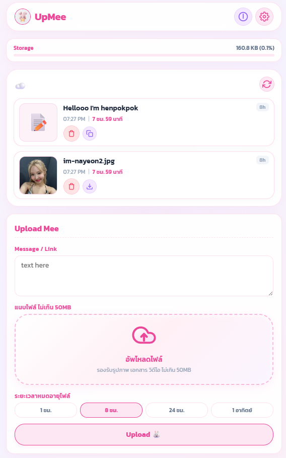

# 📦 UpMee — Instant Cross-Platform Share (Files, Links & Text)


> A secure, lightweight, cross-platform Progressive Web Application (PWA) designed for frictionless file, link, and text sharing across Windows, Android, iOS, and iPadOS devices without cumbersome logins or bluetooth constraints.

<p align="center">
  
</p>

---

## ✨ Key Features & Problem Solved

- 🛡️ **Zero-Knowledge End-to-End Encryption (E2EE)**: Client-side AES-GCM 256-bit encryption for all text and binary files before cloud transmission. Zero plaintext leakage to Supabase.
- ⚡ **Ultra-Low CPU & Memory Profile**: IntersectionObserver lazy-decryption, LRU memory-managed Blob URL cache, and GPU-accelerated rendering.
- 📲 **Frictionless Cross-Device Transfers**: Solves the pain of sending files between different operating systems (Windows, Android, iPadOS, iOS) via a unified web interface.
- ⏳ **Custom Expiration & Self-Destruct**: Set auto-deletion timers (1 Hour, 8 Hours, 24 Hours, or 7 Days) or enable **One-Time Download** to auto-destruct immediately after retrieval.
- 🔢 **Passcode, QR Code & Direct Feed Retrieval**: Access shared content instantly in real-time or by scanning an auto-generated QR code / pairing key.
- 🧹 **Automated Database & Storage Cleanup**: Uses PostgreSQL `pg_cron` jobs and database triggers to purge expired records and storage buckets every 5 minutes.
- 📱 **Native PWA Experience**: Installable on home screens as a standalone, distraction-free app across all desktop and mobile platforms.

---

## 🏗️ Architecture Overview

- **Frontend SPA**: Vanilla JavaScript + Vite + Custom Glassmorphism design system.
- **Backend & Storage**: **Supabase** (PostgreSQL, Row Level Security, Storage Buckets, and `pg_cron` auto-cleanup).

```
[ Sender Device ] ── (Paste Text / Drag File) ──> [ UpMee PWA UI ]
                                                        │
                                                        ▼
                                              [ Supabase Backend ]
                                         (Stores File & Sets Passcode)
                                                        │
                                     ┌──────────────────┴──────────────────┐
                                     ▼                                     ▼
                            [ Recipient Device ]                [ PostgreSQL pg_cron ]
                        (Fetches via Passcode/QR)            (Purges Expired Data 5m)
```

---

## 🛠️ Step-by-Step Setup Guide

### STEP 1: Supabase Backend Setup

1. **Create a Supabase Project**:
   - Go to [supabase.com](https://supabase.com) and create a free project.
   - Copy your **Project URL** and **`anon` public API Key** from **Project Settings -> API**.

2. **Execute SQL Setup Script**:
   - Open Supabase Dashboard -> **SQL Editor**.
   - Execute the contents of [`supabase_setup.sql`](supabase_setup.sql).
   - This automatically configures:
     - The `shares` database table with UUID primary keys and passcode columns.
     - Row Level Security (RLS) policies.
     - Storage bucket limits (50MB per file).
     - The `pg_cron` background job running every 5 minutes.
     - Storage deletion triggers (`trigger_delete_share_storage`).

---

### STEP 2: Local Project Setup

1. **Install Dependencies**:
   ```bash
   npm install
   ```

2. **Environment Configuration**:
   Copy `.env.example` to `.env`:
   ```bash
   cp .env.example .env
   ```
   Add your credentials:
   ```env
   VITE_SUPABASE_URL=https://your-supabase-project.supabase.co
   VITE_SUPABASE_ANON_KEY=your_anon_key_here
   ```

3. **Start Development Server**:
   ```bash
   npm run dev
   ```
   Open `http://localhost:3000` in your browser.

---

## 📱 User Workflows

### 1. Sender Flow
- Paste text/links or drag and drop files up to 50MB.
- Choose expiration duration: 1 Hour, 8 Hours, 24 Hours, or 7 Days.
- Toggle **One-Time Download** to auto-destruct immediately after retrieval.
- Generates a 6-digit numeric passcode and an auto-embedded QR Code (`https://your-app.netlify.app/?code=123456`).

### 2. Receiver Flow (Windows, Android, iPadOS, iOS)
- Enter 6-digit passcode or scan QR code.
- Query automatically validates `code = :input_code AND expires_at > now()`.
- One-click **Copy Text to Clipboard** or **Download File**.

---

### 📜 Copyright & Portfolio Viewing Notice
© 2026 henpokpok. All rights reserved.

This repository and source code are published strictly for portfolio viewing and evaluation purposes. 
Unauthorized copying, reproduction, distribution, or commercial use of any part of this project is strictly prohibited.
